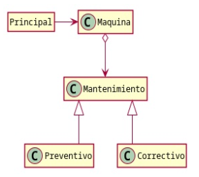

# Examen Parcial

# La fábrica

Una fábrica posee una máquina manufacturera a las que les realiza diversos mantenimientos para garantizar su correcto funcionamiento.  

Cada vez que se le realiza un mantenimiento se registra el nombre del operario que lo realiza, la fecha en que se efectuó y el importe que se gastó en repuestos.  

Existen dos tipos de mantenimiento, por un lado se realizan mantenimientos periódicos preventivos para reemplazar insumos (tales como lubricantes o repuestos de vida útil restringida) y para verificar su correcto funcionamiento. De estos mantenimientos preventivos se registra el importe gastado en insumos y el resultado del mismo, que puede ser 1 si la máquina se encuentra funcionando correctamente, 2 si se recomienda una revisión del servicio técnico del fabricante y 3 si se detecta alguna rotura.  

Por otro lado, ocasionalmente la máquina queda impedida de funcionar y se requiere un mantenimiento correctivo. En estos casos se debe registrar la cantidad de horas de parada, es decir, el tiempo transcurrido entre que dejó de funcionar y que volvió a estar operativa. También debe registrarse el total que se abonó al técnico reparador.  

Se necesita un programa que lea del archivo mantenimientos.csv la lista de todos los mantenimientos y los almacene en algún objeto (no en la función principal) que ofrezca los siguientes métodos:  

* Suma de gastos: que informe el total abonado por todo concepto en todos los mantenimientos registrados.
* Cantidad de mantenimientos caros: que informe el total de mantenimientos de cualquier tipo que hayan tenido un gasto total de más de $10.000
* Rotura más larga: que informe la fecha y el nombre del operario del mantenimiento correctivo de mayor duración.

La función principal debe ingresar los datos desde el archivo de texto y finalizar luego de imprimir el resultado de la ejecución de los tres métodos anteriores.  

El archivo posee la siguiente estructura:  

1. Tipo de mantenimiento: 1 para preventivo y 2 para correctivo  
2. Fecha: una cadena  
3. Operario: nombre del operario que realizó el mantenimiento  
4. Importe de repuestos: número de tipo float  
5. Si es un preventivo, resultado del mantenimiento (1, 2 o 3); si es un correctivo, cantidad de horas de parada.  
6. Si es un preventivo, importe de los insumos; si es un correctivo, importe que cobró el técnico.

### Modelo tentativo

